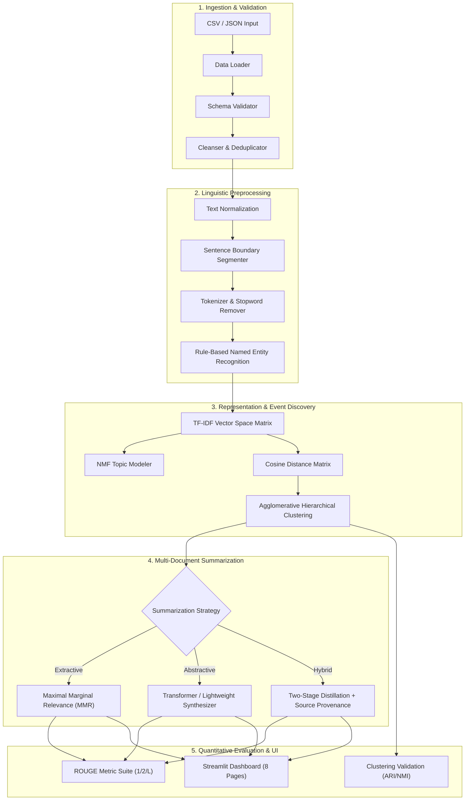

# NewsLens System Architecture & Technical Specification

This document details the architectural design, algorithmic components, mathematical foundations, data pipelines, and design patterns utilized in **NewsLens**.

---

## 🏗️ 1. High-Level Architecture Overview

NewsLens is designed as a decoupled, layered NLP architecture where core algorithmic processing is strictly separated from presentation and user interface layers.



---

## 🔄 2. Component Breakdown

### 2.1 Ingestion & Cleaning Subsystem (`src/data_loader.py`)
* **Multi-Format Support:** Robust parsing of UTF-8 and Latin-1 CSV and JSON files using `pandas`.
* **Validation Layer:** Enforces mandatory presence of `title` and `text` columns; flags missing columns prior to execution.
* **Integrity Cleansing:** Trims whitespace, eliminates empty or null strings, strips duplicates based on body text hashing, and synthesizes sequential article identifiers (`art_001`, `art_002`, ...).

### 2.2 Text Preprocessing Subsystem (`src/preprocessing.py`)
* **Normalization:** Strips non-standard characters, HTML entities, and external URLs while preserving sentence casing and punctuation essential for sentence parsing.
* **Sentence Segmentation:** Context-aware regex splitting that handles honorific abbreviations (*e.g., Dr., Prof., Inc.*) and numeric decimals without premature segmentation.
* **Tokenization:** Lowercasing, punctuation stripping, token filtering (minimum token length = 2), and English stopword elimination.
* **Entity Extraction:** Lightweight rule-based detection for key dates, monetary and percentage figures, and title-case proper nouns.

### 2.3 Topic Modeling Subsystem (`src/topic_modeling.py`)
* **Algorithm:** Non-Negative Matrix Factorization (NMF) with TF-IDF representation.
* **Objective Function:**
  $$\min_{W, H \ge 0} \frac{1}{2} \|V - WH\|_F^2 + \alpha \|W\|_1 + \alpha \|H\|_1$$
  Where $V$ is the document-term matrix ($N \times M$), $W$ is the document-topic matrix ($N \times K$), and $H$ is the topic-term matrix ($K \times M$).
* **Advantage:** Unsupervised, highly interpretable additive components without negative values, executing on CPU in milliseconds.

### 2.4 Event Discovery Subsystem (`src/similarity.py`, `src/event_clustering.py`)
* **Vector Space:** Document-level TF-IDF vectors normalized to unit length ($L_2$ norm).
* **Distance Formulation:** Precomputed cosine distance:
  $$D_{\text{cosine}}(u, v) = 1 - \frac{u \cdot v}{\|u\|_2 \|v\|_2}$$
* **Clustering Algorithm:** Agglomerative Hierarchical Clustering with average linkage:
  $$d(A, B) = \frac{1}{|A||B|} \sum_{a \in A} \sum_{b \in B} D_{\text{cosine}}(a, b)$$
* **Distance Threshold:** Tunable cutoff ($\tau = 0.75$), allowing the system to discover an arbitrary, natural number of events without hardcoding cluster counts.

### 2.5 Summarization Subsystems
* **Extractive Summarization (`src/extractive_summarizer.py`):**
  Uses **Maximal Marginal Relevance (MMR)** to balance salience and redundancy:
  $$\text{MMR} = \arg\max_{s_i \in C \setminus S} \left[ \lambda \cdot \text{Sim}(s_i, \text{Centroid}) - (1 - \lambda) \cdot \max_{s_j \in S} \text{Sim}(s_i, s_j) \right]$$
  where $\lambda = 0.7$, balancing central factual alignment against cross-sentence repetition.
* **Abstractive Summarization (`src/abstractive_summarizer.py`):**
  Hugging Face transformer pipeline (*e.g., DistilBART-CNN*) with an automatic, zero-dependency deterministic heuristic fallback for offline/CPU setups.
* **Hybrid Summarization (`src/hybrid_summarizer.py`):**
  A two-tier pipeline where extractive filtering distills the multi-document factual core, followed by abstractive cohesion synthesis, alongside strict passage-level source provenance linking.

### 2.6 Evaluation Subsystem (`src/evaluation.py`)
* **ROUGE Suite:** Computes ROUGE-1 (unigram overlap), ROUGE-2 (bigram overlap), and ROUGE-L (Longest Common Subsequence) precision, recall, and F1 scores against human references.
* **Cluster Validation:** Calculates Adjusted Rand Index (ARI) and Normalized Mutual Information (NMI) against ground-truth event labels.
* **Profiling:** Measures execution time across all pipeline stages, computing throughput (articles/second).

---

## 📐 3. Data Flow Diagram

```
[Raw Articles (CSV/JSON)]
       │
       ▼
 [Cleaned DataFrame] ──► [Processed DataFrame: sentences, tokens, entities]
                               │
               ┌───────────────┴───────────────┐
               ▼                               ▼
       [TF-IDF Matrix]                 [NMF Latent Topics]
               │                               │
               ▼                               ▼
    [Cosine Distance Matrix]           [Topic Keywords & Dist.]
               │
               ▼
 [Agglomerative Clustering] ──► [Discovered Candidate Events]
                                               │
                                               ▼
                                  [Summarization Engine]
                                  ├─ Extractive (MMR)
                                  ├─ Abstractive (Neural)
                                  └─ Hybrid (with Provenance)
                                               │
                                               ▼
                                 [ROUGE & ARI Evaluation]
```

---

## ⚡ 4. Computational Efficiency & Hardware Profile

* **Hardware Compatibility:** Fully optimized for CPU architectures (Intel/AMD/Apple Silicon). No GPU required.
* **Memory Footprint:** Under 150 MB RAM for standard processing runs.
* **Latency:** End-to-end benchmark run (< 0.15s for 12 articles).
